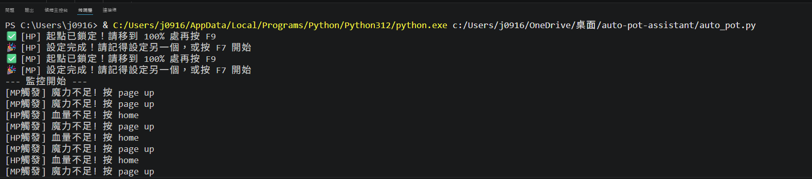

##### 桌面端狀態監控自動化工具 (Desktop Status Monitor)

這是一個基於 Python 與 Windows 內建 API 開發的輕量級桌面自動化工具。透過螢幕像素偵測技術，能即時監控特定區域的狀態變化（例如遊戲中的血量/魔力條），並自動觸發對應的鍵盤按鍵，達到自動化輔助的效果。

## 開發動機與專案成效

開發此腳本的初衷，是為了**實現比手動更快、更精準的高 CP 值補品自動化使用**。
* **即時反應：** 透過程式即時影像辨識，反應速度遠超越手動操作與內建系統的延遲。
* **資源最佳化：** 讓玩家能自動且精準地使用「容量小但 CP 值高」的補品，或是原先只能依賴玩家手動點擊的特殊道具。
* **長時間穩定運作：** 可持續運作並確保角色狀態維持在安全範圍。

**【終端機運作實測畫面】**

###### 核心技術與亮點

\* 極致輕量化： 捨棄龐大的傳統截圖辨識套件 (如 OpenCV/Pillow)，直接呼叫 Windows 底層 API (`ctypes.windll.gdi32.GetPixel`) 進行單點像素取樣，大幅降低 CPU 與記憶體消耗。

\* 完整 GUI 介面：\*\* 使用 `tkinter` 打造直覺的操作面板，支援雙通道（如 HP/MP）獨立設定觸發門檻與對應按鍵。

\* 智慧座標校正：\*\* 內建兩段式熱鍵 (F9) 座標鎖定系統，使用者不需手動查詢與輸入複雜的 X/Y 座標即可完成精準定位。

\* 狀態持久化：\*\* 程式關閉時會自動將使用者習慣（座標、門檻值、自訂按鍵）寫入本地端的 `config.json`，確保下次開啟時能無縫接軌。

###### 環境與套件需求

本專案主要依賴 Python 內建標準庫，僅需額外安裝鍵盤監聽套件即可運行。

\* Python 3.x

\* `keyboard` 模組

\* `tkinter` 模組

###### 如何安裝與執行

1\. 下載專案：

&#x20;  將本專案的程式碼下載至本機電腦中。

2\. 安裝必備套件：

&#x20;  請在終端機 (Terminal) 中輸入以下指令安裝相依的模組：

&#x20;  `pip install -r requirements.txt`

3\. 啟動程式：

&#x20;  在終端機輸入以下指令啟動主程式：

&#x20;  `python auto_pot.py`

###### 使用說明

1\. 開啟程式後，在介面上選擇欲設定的目標（如 HP 或 MP）。

2\. 將滑鼠游標移至狀態條的「起點（空狀態）」，按下 `F9` 鎖定。

3\. 將滑鼠游標移至狀態條的「終點（全滿狀態）」，再次按下 `F9` 完成校正。

4\. 調整好觸發百分比（%）與對應的鍵盤按鍵後，按下 `F7` 即可開始背景監控。再次按下 `F7` 即可停止。

